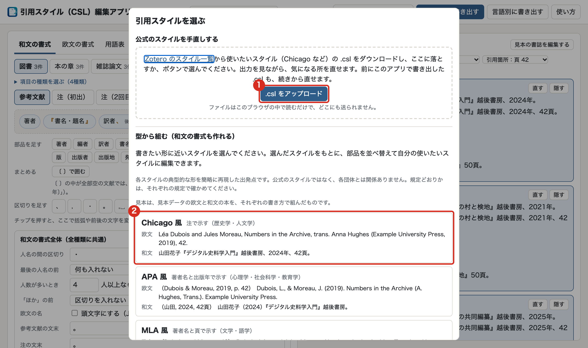
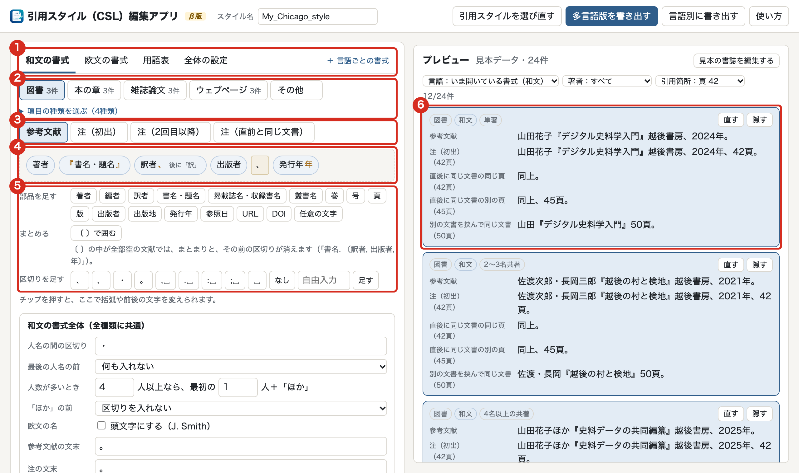
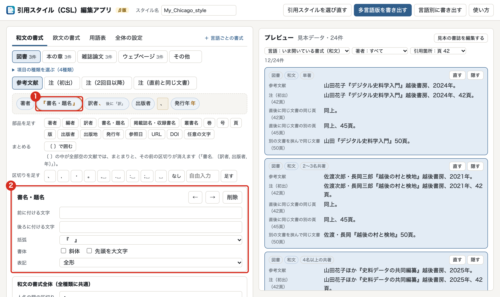
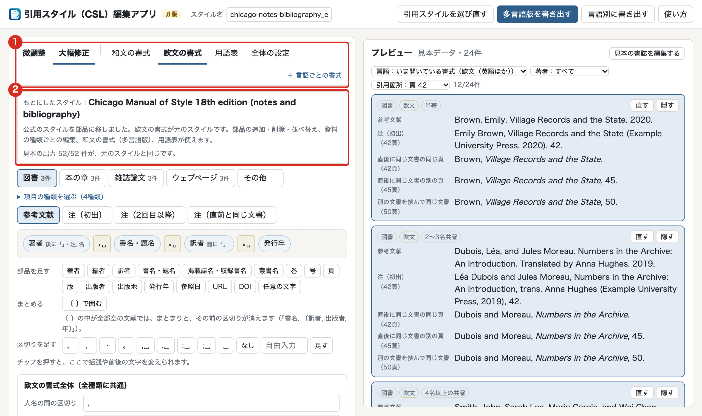
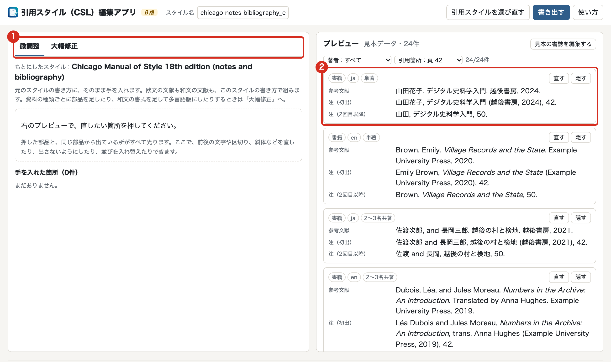
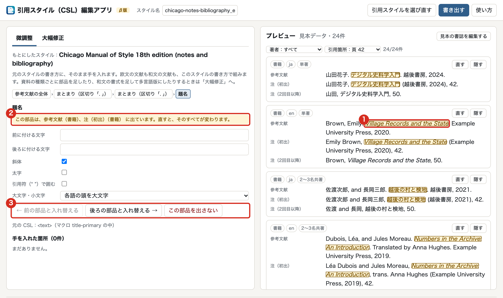
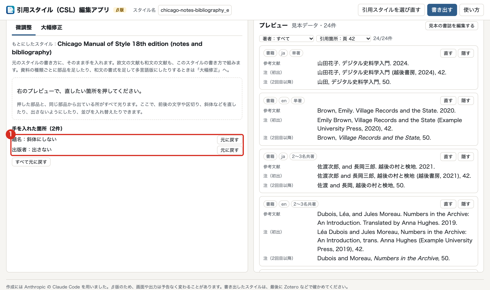
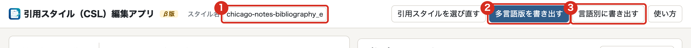

<!-- _class: title -->

# 引用スタイル（CSL）編集アプリ

## 使い方

v0.1.0（2026年11月）

---

# このアプリでできること

- 日本語の画面で、**引用スタイル（CSL）** を作る・直す
  - CSL は、注や参考文献の書き方を記述する形式。Zotero などの文献管理ソフトが読む
- 作ったスタイルを Zotero に入れると、Word・LibreOffice・Google ドキュメントで 注と参考文献リストがその書き方で組まれる
- **和文と欧文を書き分けられる**。文献ごとに、Zotero の「言語」欄で自動で切り替わる
- ブラウザで開くだけで使える。ネットにつながっていなくても動く
- 読み込んだ書誌や .csl は**ブラウザの中だけで処理し、外部には送らない**

β版のため、画面や出力は予告なく変わることがある。書き出したスタイルは、最後に Zotero などで確かめる

---

# 3つの使い方

| 使い方 | 出発点 | 向いているとき | 和文の書式 |
|:---|:---|:---|:---:|
| **型から組む** | Chicago 風・APA 風・MLA 風・IEEE 風 | 書きたい形が決まっていて、一から並べたい | 作れる |
| **公式のスタイルを微調整** | Zotero で公開されている .csl | 区切りや斜体など、少しだけ直したい | 作れない |
| **公式のスタイルを大幅修正** | 同上 | 公開されたスタイルを土台に、並びを大きく変えたい・和文の書式を足したい | 作れる |

- 「型から組む」と「大幅修正」は、**同じ画面（部品を並べる画面）** で操作する
- 微調整と大幅修正は、公式のスタイルを読み込んだあと、画面の左上でいつでも切り替えられる
- 4つの型は典型的な形を簡略に再現した出発点で、公式のスタイルではない

---

# 最初の画面：引用スタイルを選ぶ

1<b>公式のスタイルを手直しする</b>：.csl をアップロードする。前にこのアプリで書き出した .csl もここから読み込み、続きから直せる

2<b>型から組む</b>：書きたい形に近い型を押す。和文と欧文の見本で、仕上がりの形を見比べられる

この画面は、上の「引用スタイルを選び直す」かアプリ名を押すと、また開く。<b>いまの編集は置き換わる</b>

---

<!-- _class: section-divider -->
<!-- _paginate: skip -->

1

# 部品を並べる（型から組む・大幅修正）

---

# 部品を並べる画面の見方

1書式：<b>和文の書式</b>・<b>欧文の書式</b>・用語表・全体の設定

2資料の種類：図書・本の章・雑誌論文・ウェブページ。ほかの種類は「項目の種類を選ぶ」で足す。足していない種類は「その他」の並びで組む

3参考文献・注（初出）・注（2回目以降）・注（直前と同じ文書）を切り替える

4いま組んでいる並び。チップ（部品）をドラッグか ← → で並べ替える

5部品・まとまり・区切りを足す

6プレビュー。直すと、すぐに組み直される

---

# チップを直す

1直したいチップを押す

2下に詳細が開く

<ul>
<li>前に付ける文字・後ろに付ける文字</li>
<li>括弧（『 』「 」など）</li>
<li>斜体などの書体</li>
<li>← → で隣と入れ替え、「削除」で外す</li>
</ul>

押したチップは赤く囲まれる。プレビューで、変わった所を確かめながら直す

---

# 区切りとまとまり：空の欄があっても崩れないしくみ

- **区切り**（、 , . など）は、チップの間に置く。**両側に部品があるときだけ出る**
  - 部品が空の文献では、その部品と、その前の区切りが消える
- **まとめる**：「〔 〕で囲む」で部品をまとめると、中が全部空の文献では、まとまりごと消える

書名 〔訳者、出版者、年〕 と組んでおくと

訳者がいる本：『人文学のための計量分析入門』長野壮一訳、人文書院、2025年。 訳者がいない本：『人文学のためのテキストデータ構築入門』文学通信、2022年。

- 括弧（ ）は、まとまりの前後に付けると、中身が無いときに**空の括弧が残らない**
- Zotero で公開されているスタイルも、同じしくみ（CSL の group）で空の欄を処理している

---

# 和文と欧文：Zotero の「言語」欄で決まる

| Zotero の「言語」欄 | 組まれる書式 |
|:---|:---|
| ja | 和文の書式 |
| en・fr・de など | 欧文の書式 |
| 空欄・言語コードとして読めない値 | 和文の書式（プレビューに警告が出る） |

- 取り込んだ書誌の「言語」欄は、空欄や「日本語」「jpn」など、まちまち。 **ja・en などの言語コードに直しておく**
- フランス語の文献は « » で組みたい、など言語ごとに変えたいときは、 「＋ 言語ごとの書式」から言語コードを入れて書式を足す
- 2回目以降の注の短縮形には、Zotero の「簡略タイトル」欄が使われる
  - 直前の注と同じ文書なら「同上」（頁が違えば「同上、45頁。」）。書き分けは「全体の設定」で切れる

---

# 大幅修正：公式のスタイルを部品に移す

1公式のスタイルを読み込んだあと、左上の「<b>大幅修正</b>」を押す。部品を並べる画面に変わる

2帯に、もとにしたスタイルと、見本の出力が元のスタイルと同じ件数が出る。違う見本は一覧で出る

<ul>
<li><b>欧文の書式</b>が元のスタイル</li>
<li><b>和文の書式</b>を足して、多言語版にできる</li>
<li>操作は「型から組む」と同じ</li>
</ul>

---

<!-- _class: section-divider -->
<!-- _paginate: skip -->

2

# 微調整（公式のスタイルに少しだけ手を入れる）

---

# 公式のスタイルを手に入れる

1. Zotero Style Repository（ https://www.zotero.org/styles ）でスタイルを探す
2. スタイル名を**右クリック**し、「名前を付けてリンク先を保存」 （Safari は「リンク先のファイルをダウンロード」）で .csl を保存する

**ふつうにクリックすると**、Zotero Connector がスタイルを Zotero に入れてしまい、ファイルは手元に残らない

- そうなったときは、Zotero のデータディレクトリの **styles** フォルダにある .csl を読み込む
  - データディレクトリは、Zotero の「設定」→「詳細」→「データディレクトリを表示」で開く

<!-- TODO: 各ブラウザの右クリックの項目名、保存したファイルの拡張子が .csl のままか、Zotero 日本語版の「詳細」「データディレクトリを表示」の表記、styles フォルダに .csl として置かれることを実機で確認する -->

---

# 読み込んだ画面

1最初は「<b>微調整</b>」が開く。「大幅修正」にはいつでも切り替えられる

2プレビューは、元のスタイルの出力のまま

微調整では、欧文の文献も和文の文献も、元のスタイルの書き方で組む。和文の書式を足すときは「大幅修正」へ

スタイル名は、ファイル名に _edited を付けた名前になる

---

# 直したい箇所を押す

1プレビューで直したい箇所を押す。<b>同じ部品から出ている所が、すべて光る</b>

2直すと変わる範囲（参考文献と注など）が出る

左で、前後の文字・斜体・太字・大文字小文字を直す

3隣の部品と入れ替える、出さないようにする

---

# 手を入れた箇所は、1件ずつ元に戻せる

1手を入れた箇所が一覧になる

<ul>
<li>「元に戻す」で1件ずつ戻せる</li>
<li>「すべて元に戻す」で読み込んだ直後に戻る</li>
</ul>

手を入れていない部分は、元のスタイルのまま残る

---

<!-- _class: section-divider -->
<!-- _paginate: skip -->

3

# 書き出して使う

---

# 自分の文献で試す

- 読み込まなくても、見本の書誌（和文・欧文の24件）で試せる
- 自分の文献で確かめるとき
  1. Zotero で文献を選び（Ctrl か ⌘ を押しながらで複数）、右クリック → 「選択された項目をエクスポート...」
  2. 形式で **CSL JSON** を選んで保存する
  3. プレビューの「**見本の書誌を編集する**」→「Zotero から自分の文献を取り込む」で、 保存したファイルを選ぶ
- 各文献の「直す」で書誌を書き換え、「隠す」でプレビューから外せる。 Zotero のデータは変わらない
- Zotero の「参考文献を作成」でコピーした文章は使えない（整形済みの文字のため）

---

# 書き出す

1**スタイル名**：半角の英字・数字と _ - . ( ) と空白で付ける（日本語は使えない）

2**多言語版を書き出す**：和文と欧文を1つのスタイルで書き分ける。**ふつうはこちら**

3**言語別に書き出す**：書式ごとに別のスタイルを作る。pandoc など、言語による書き分けに対応しないソフト向け（2つ以上選ぶと zip にまとめる）

- 微調整のときは、ボタンは「**書き出す**」1つになる
- 書き出した .csl をアプリに読み込めば、続きから直せる

---

# Zotero に入れて、ワープロで使う

1. Zotero の「設定」→「引用」→「**＋**」から、書き出した .csl を選ぶ
   - 多言語版では、確認の画面が出る場合がある。OK で入れられる
2. ワープロで、文書の引用スタイルを切り替える
   - Word・LibreOffice：Zotero のボタンの **Document Preferences**
   - Google ドキュメント：Zotero のメニューの **Preferences**
3. 注と参考文献リストを確かめる
   - 和文の文献と欧文の文献が、それぞれの書式で組まれているか
   - 違っていたら、Zotero でその文献の「言語」欄を見直す

- 直したスタイルを入れ直すときは、同じ名前のまま入れれば、Zotero では同じスタイルの更新になる

---

# できないこと・気をつけること

- **五十音順に並べること**
  - Zotero には著者名の読みの欄が無い。参考文献リストは漢字の文字コード順に並ぶ
  - 読みを持てる Zotero の派生版 Jurism もある
- **規定どおりかの保証**
  - 4つの型は出発点。提出先の規定と見比べて確かめる
- **Zotero との細部の一致**
  - 組版エンジンは、Zotero が中で使っているのと同じ版の citeproc-js。ただし Zotero 側で 手が入っているので、細かい出力が違うことがある。最後は Zotero で確かめる
- **多言語版は Zotero 向け**
  - 多言語版は CSL の拡張（CSL-M）を使う。標準の CSL しか読まないソフトでは、 「言語別に書き出す」を使う

---

# このアプリについて

- アプリ：https://ayanosk.github.io/csl-editor/
- ソースコード：https://github.com/ayanosk/csl-editor （AGPL-3.0）
- 不具合や気づいたこと：https://github.com/ayanosk/csl-editor/issues
- 組版エンジン：citeproc-js 2.4.63（© 2009-2019 Frank Bennett、CPAL 1.0 または AGPL 3.0）
- ロケール：CSL プロジェクトの locales（CC BY-SA 3.0）
- 作業中の状態は、そのブラウザの中（localStorage）にだけ保存される

作成：小風綾乃（2026年）。作成には Anthropic の Claude Code を用いた。画面は v0.1.0 で撮影

